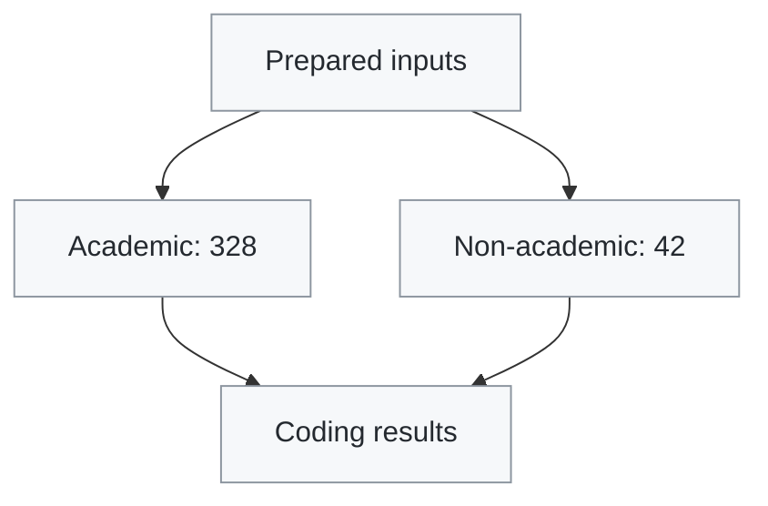

# RAAC terminology coding

Seven-label, non-exclusive string-occurrence coding for 328 academic records and 42 UK non-academic files. Records and files are coded independently, without record-specific matching exclusions or deduplication.

## Associated research

This repository provides the terminology-coding scripts and supporting outputs for Objective 1 of the manuscript:

*An Artificial Intelligence-Assisted Framework for Terminology-Sensitive Literature Screening in Safety-Critical Construction: Reinforced Autoclaved Aerated Concrete in the UK.*

It supports the analysis of seven terminology labels across academic and UK non-academic sources. It does not implement the AI-assisted screening workflows or their performance evaluation.

## Public data availability

The repository provides bibliographic inventories, coding scripts, record-level codes, match evidence and aggregate results. Abstracts in the source export and prepared title/abstract files are redacted. Academic evidence contexts are also redacted. These are publication-only post-processing steps, not part of terminology matching or aggregation; the deposited codes, match counts and aggregate results are unchanged.

Full-document text and source PDFs are not distributed. To rerun the complete analysis, obtain the corresponding abstracts and documents and prepare the inputs in the formats described in the relevant data-folder README files. Redacted placeholders must not be used as analytical text.

## Project structure

```
raac-terminology-coding/
├── source/
│   ├── academic_records_328.csv
│   ├── academic_corpus_328_covidence_export.csv  # abstracts redacted
│   └── nonacademic_documents_42.csv
├── data/
│   ├── academic/
│   │   ├── title_abstract/  # 328 format-reference files; abstracts redacted
│   │   └── fulltext/        # input-format documentation; supply text separately
│   └── nonacademic/
│       └── fulltext/        # input-format documentation; supply text separately
├── scripts/
│   ├── local_inputs.py                         # loads academic record metadata, prepared titles/abstracts and full-text pages
│   ├── term_coding_core.py                     # shared text preprocessing and seven-label matching
│   ├── run_objective1_academic_coding.py        # codes 328 academic records and writes results
│   ├── run_objective1_nonacademic_coding.py     # codes all 42 non-academic files and writes results
│   ├── prepare_academic_title_abstract.py       # prepares title/abstract text from the source CSV
│   ├── prepare_academic_fulltext.py            # extracts page-separated text from academic PDFs
│   └── check_inputs.py                         # optionally checks required input files are present
└── results/
    ├── academic/
    │   ├── academic_lexical_codes_328.csv
    │   ├── academic_lexical_evidence.csv         # context redacted
    │   └── academic_lexical_summary.json
    └── nonacademic/
        ├── nonacademic_lexical_codes_42.csv
        ├── nonacademic_lexical_evidence.csv
        └── nonacademic_lexical_summary.json
```

## Workflow at a glance



The diagram shows the coding workflow only. Academic excerpt and abstract redaction is a separate publication-only step.

1. **Prepare inputs.** Obtain the required unredacted abstracts and full documents. `prepare_academic_title_abstract.py` reads the source export and writes 328 prepared title/abstract text files to `data/academic/title_abstract/`. If preparing academic text from PDFs, `prepare_academic_fulltext.py` reads PDFs from `source/academic_pdfs/` and writes page-separated text to `data/academic/fulltext/`. Prepare the 42 non-academic text files in the category folders documented under `data/nonacademic/fulltext/`.
2. **Check inputs (optional).** Run `check_inputs.py` to check required filenames and file presence. This does not verify text completeness or replace redacted abstracts.
3. **Run coding.** Run `run_objective1_academic_coding.py` for the 328 academic records and `run_objective1_nonacademic_coding.py` for all 42 non-academic files. Both use the same seven-label matching rules.
4. **Inspect outputs.** Each runner writes three files to its corresponding `results/` subfolder: a record-level coding CSV, a match-evidence CSV and an aggregate-summary JSON. Existing files are replaced by a successful run.
5. **Prepare for public release.** Separately redact academic evidence contexts and abstract inputs before publication, while retaining complete originals privately. This post-processing is not part of coding and does not change the calculated codes or summaries.

`local_inputs.py` and `term_coding_core.py` are imported modules, not additional steps to run manually. The former loads prepared academic inputs; the latter performs shared text preprocessing and label matching.

## Input preparation details

Use Python 3.10 or newer. Coding uses the standard library; PDF extraction additionally requires `pypdf`.

1. Supply unredacted abstracts in the source export, keeping the existing record identifiers and columns. Run `python3 scripts/prepare_academic_title_abstract.py` to prepare the 328 title/abstract inputs.
2. Supply the academic full-text inputs for the 231 records designated `full_text`. Alternatively, place the corresponding PDFs in `source/academic_pdfs/` and use `scripts/prepare_academic_fulltext.py` after installing `pypdf`.
3. Supply the 42 non-academic text inputs in the documented category folders.

See the README files under `source/` and `data/` for filenames and text formats. Re-extraction with different tools, document versions or updated webpages may change matches; the supplied extraction script is not a guarantee of exact reproduction of the deposited text.

## Run coding

After preparing complete, unredacted inputs, run from this repository directory:

```sh
python3 scripts/check_inputs.py
python3 scripts/run_objective1_academic_coding.py
python3 scripts/run_objective1_nonacademic_coding.py
```

Input checking is optional and separate from calculation. File-presence checks do not verify that redacted abstracts have been replaced. Each successful coding run replaces that side's output files in `results/` and regenerates unredacted evidence. Reapply publication redaction before sharing regenerated academic evidence.

## Coding and outputs

Academic input groups comprise 231 full-text records, 89 title-and-abstract records and 8 title-only records. Available titles and abstracts are also coded as separate scopes. All 42 non-academic files are coded at full-document level and included in aggregation.

The seven labels are RAAC acronym, RAAC full phrase, reinforced AAC, AAC acronym, AAC full phrase, ALC acronym and ALC full phrase. Labels may overlap. Binary flags indicate string occurrences, not conceptual relevance; unavailable scopes are recorded as `NA`.

Each side produces a record-level code table, a match-evidence table and a JSON summary. Academic evidence contexts in the public release are replaced with `[REDACTED: third-party text]`; identifiers, scopes, labels, pages and matched terms remain available.

The academic summary field `n_title_only=10` counts records without abstracts, including 2 records with full text; the actual title-only input group is 8.

Reference truncation operates within a text block and does not automatically suppress subsequent bibliography pages in paginated input. No AI calls or relevance adjudication are performed.

## License

The project's original code is licensed under the MIT License; see `LICENSE`.
The software license applies to the project's original code only. Third-party
source materials are not covered by this license and remain subject to their
respective rights and licenses. This license does not grant permission to
redistribute third-party article text, abstracts or other source documents.
No separate data or documentation license is granted by this statement.

## Citation

If you use this software, please cite the repository using `CITATION.cff` or
GitHub's **Cite this repository** feature. The associated manuscript is listed
above; its publication citation can be added when available.

## Dependencies

The coding runners require Python 3.10 or newer and no third-party packages.
For optional PDF text preparation, install the dependency with:

```sh
python3 -m pip install -r requirements.txt
```

`requirements.txt` lists the optional extraction dependency, not a locked
historical environment. Dependency and extraction differences may affect
re-extracted text.
